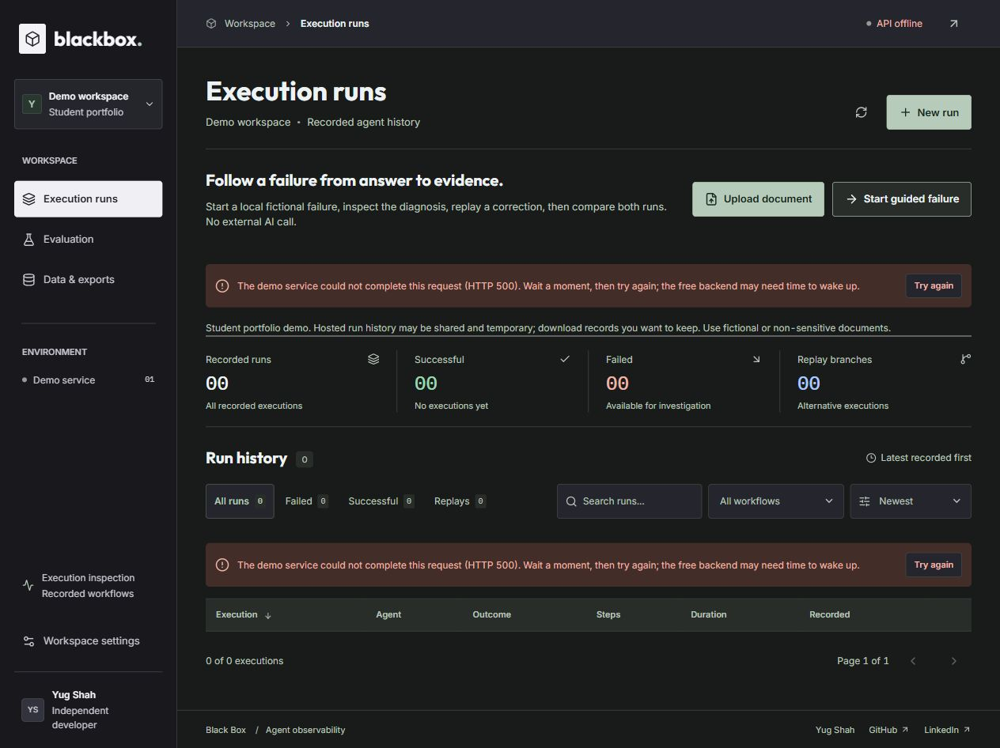
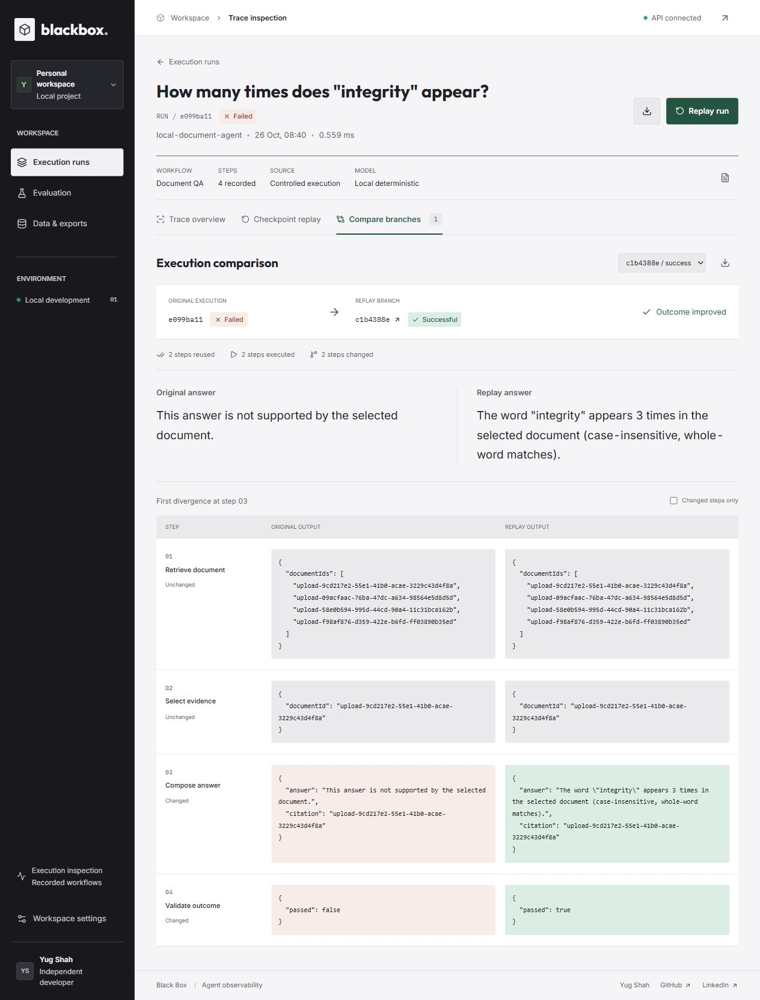

# Broader QA — 26 October 2026

This pass verifies the integration prototype beyond the guided happy path. It is a bounded test record, not a statement that every website scenario is complete. No production deployment or main merge was performed. No paid generation/provider calls were used.

## Local browser checks

The Next.js 16.4.1 production-mode frontend used the local single-worker API. All upload fixtures contain only fictional campus text with three whole-word occurrences of “integrity.”

| Check | Observation |
|---|---|
| TXT / MD / text PDF / DOCX upload | One four-format batch produced four correct previews; original PDF source returned count 3; selection replays using TXT, MD and DOCX each returned count 3 and passed checks. This is not four separate standalone upload runs. |
| Mixed valid text + malformed PDF | Filename-specific parser error; no partial batch accepted; execution stayed disabled. |
| Empty text file | Rejected with the 1–10,000 character requirement. |
| Retry after upload error | Valid DOCX preview restored; question field usable again. |
| Dialog keyboard use | Escape closed the dialog and returned focus to Upload document. |
| Comparison export | Actual downloaded JSON parsed successfully; original/replay IDs, DOCX selection and success outcomes matched the selected branch. |
| API outage | Stopped only the identified local API process. The page settled out of loading, exposed retry controls, and rejected guided creation without recording a run. |
| API restart | Restarted the same store; saved document-store SHA-256 stayed `91BF8795AE9444AA29003233CE507F5D5F48066AA8F6746AF822C11675778BF6`. Retry restored history in place. |
| Improved outage message | New built frontend displayed the HTTP status plus wait/retry/free-backend guidance, replacing generic “Request failed (500).” Screenshot below. |
| Themes | Light and dark selections persisted across reload. |
| Phone navigation | 390px viewport; evaluation page document width 375px, no page overflow. Menu Escape closed navigation and restored the opener's focus. |
| Additional pages | Homepage navigation, evaluation metrics and data/export counts loaded. This is not a complete visual/accessibility audit of every page in every theme. |

## Hosted old-release check

On `https://blackbox-ai-delta.vercel.app`, the existing public release accepted the same four-format fictional batch. Local mode was explicitly selected; Gemini was not invoked. A DOCX word-count run with an injected unsupported answer failed, diagnosis identified step 3, and a literal count correction succeeded with two reused and two executed steps.

Actual browser downloads verified:

- Original `doc_e099ba11…`: failed before and after replay; exported JSON objects equal.
- Replay `doc_c1b4388e…`: success, answer contains “appears 3 times.”
- Comparison JSON: reused steps `[1, 2]`, failed original and successful replay.

These checks demonstrate connectivity and this specific hosted upload/answer/replay/export flow. They do **not** mean the new integration is deployed. Fictional records were left in shared public history; no existing records were deleted. Free-host history may disappear later.

## Backend checks and fixes

Eight targeted existing regression tests passed, followed by an isolated matrix for both arithmetic and document workflows: invalid create/replay requests preserved stored bytes; failed atomic writes returned 503; wrong corrections remained failed; correct corrections succeeded; originals and their checkpoints remained equal; fresh Python subprocesses reloaded originals correctly.

The matrix exposed a failure when both persistence and temporary-file cleanup fail: cleanup masked the intended JSON 503 with a generic 500. The fix treats cleanup as best effort and preserves the primary error. Its regression passed after failing before the fix. Original bytes stay intact; a denied cleanup can leave a temporary file requiring later manual cleanup. This is disclosed, not silently treated as successful persistence.

## Stalled requests and cancellation

Shared execution/history/replay API requests now use a 90-second active-browser-time deadline, combined with caller cancellation. Tests cover stalled request headers, stalled response bodies, active caller cancellation and preservation of validation/server details. Timeout guidance tells users to refresh history before retrying because server-side work may already have saved a submitted run; client timeout is not transaction rollback or idempotency.

The timeout is exercised with controlled unit signals, not a claimed 90-second browser network-stall experiment. Upload cancellation and parser timeout/busy handling have separate existing regression checks; this is not a universal deadline for every possible browser operation. Modern browser support for AbortSignal timeout/any is required.

## Retrieval stress review

A separate fresh-context agent froze a fictional corpus and questions before scoring, without inspecting the implementation or earlier metrics. Current v3 ranked a relevant current source first for 12/12 supported questions versus v2's 7/12, but abstained on **0/4** unsupported questions versus **3/4** before. The wider lexical matcher therefore has a demonstrated answerability weakness. The corpus was not tuned after results. See [protocol and paired reports](RETRIEVAL_REVIEW_PROTOCOL.md).

## Remaining limits

- No real Gemini answer was requested in this pass; provider behavior and quotas remain unverified here.
- No hard power-loss test, cross-process concurrent-write test or distributed-storage guarantee; one backend worker remains required.
- No independent-human or real-user retrieval evaluation, production certification, comprehensive accessibility audit or universal answer-accuracy claim.
- Main merge and production deployment require owner authorization after review. The public release still has its prior code/dependencies.
