# Understand and defend Black Box

Use this with the two-minute walkthrough in [PORTFOLIO_HANDOFF.md](PORTFOLIO_HANDOFF.md). The website is a student prototype for inspecting a small recorded workflow. It is not an autonomous bug fixer or a private document service.

## Follow one question

```mermaid
flowchart LR
    UI[Next.js interface] --> API[FastAPI request validation]
    API --> R[1 Retrieve sources]
    R --> S[2 Select current source]
    S --> G[3 Produce output]
    G --> V[4 Check evidence]
    V --> Store[Save trace and checkpoints]
    Store --> Inspect[Inspect and diagnose]
    Inspect --> Replay[Replace a checkpoint output]
    Replay --> Branch[Save a new run]
    Store --> Compare[Compare original and branch]
    Branch --> Compare
```

The real implementation saves checkpoint snapshots around step execution before persisting the completed record. The diagram summarizes the user journey rather than transaction timing. The frontend proxies `/api/blackbox/...` to FastAPI. The backend validates the request, runs four steps and saves inputs, outputs, IDs and timings. The UI displays these observations; it does not reconstruct an unobserved provider's internal reasoning.

| Step | Input and output | What can go wrong in the demo |
|---|---|---|
| Retrieve (1) | Question and supplied documents → candidate IDs | No candidates or an irrelevant candidate |
| Select (2) | Candidate documents → one document ID | Archived or unsuitable source |
| Compose (3) | Question and selected text → answer and citation | Wrong count, unsupported text, provider error |
| Validate (4) | Recorded answer, source and evidence → passed/failed | Citation, quote or expected-output checks fail |

In local mode, ordinary questions return a source extract. Explicit single-word frequency questions compute a count. Optional Gemini answering is a separate path requiring consent; the recent QA used local mode and made no paid provider calls. A matching extract can be perfectly copied yet fail to answer the question.

## Explain a replay accurately

A checkpoint contains the saved configuration, accumulated state and earlier steps. Replaying at step 3 reuses steps 1–2, substitutes a reviewed answer/citation, and executes the remaining validation. The system creates a new run ID and new checkpoint IDs. It does not edit the original to make the demonstration look successful.

A replay from an earlier step can re-execute more of the workflow. “Executed” alone does not prove an external model was called: a manual replacement is also an executed step. This is why the new output labels inspect recorded response evidence rather than trusting the agent/model name.

The backend checks that restored configuration, prefix and state agree with the recorded original. Inconsistent saved observations return 409; malformed replacement content can return 422; a storage failure returns 503. Run/checkpoint collision guards prevent an existing identifier from being overwritten. Atomic local writes and a process lock support the single-worker demo; they are not a distributed database or a guarantee against every power-loss scenario.

## Read labels and metrics without overstating them

| Statement | What you can defend |
|---|---|
| Literal source extract | The output matches text in its cited source; it may not answer the question. |
| Recorded word count | The output matches the locally computed expected count saved in this run. |
| Provider-generated answer | Matching recorded response evidence backs the output; this does not prove semantic truth. |
| Successful | This workflow's bounded checks passed; it is not a general accuracy score. |
| Diagnosis points to step 3 | Rules found evidence of a likely origin; they did not establish causal proof. |
| Top-1 source selection | The first current source agrees with the fixture's relevance labels. |
| MRR | Average reciprocal rank of the first relevant source; first earns 1, second earns 1/2. |
| Recall@3 | Fraction of labeled relevant sources appearing in the first three candidates, averaged over positive queries. |
| Unsupported abstention | The retriever returned no source for a query labeled unsupported. |

The original synthetic retrieval result was 4/17 → 15/17 top-1. A separately frozen synthetic review was 7/12 → 12/12, but unsupported abstention became worse: 3/4 → 0/4. Keep those sets separate. Neither measures generated-answer accuracy. The later abstention study failed its acceptance rule and did not change runtime behavior; its apparent 20/20 source agreement also includes a disclosed debatable relevance label.

There are two distinct forms of diagnosis in this project. Document diagnosis uses rules. The arithmetic experiment trains logistic regression on hand-engineered trace-consistency features and synthetic cases. Its perfect synthetic scores do not establish real-world generalization, calibrated confidence or an advantage over the reported domain-rule baseline. Do not describe the document retriever as a trained language model.

## Practice these answers

**Why lexical retrieval?** The supplied collection is small, the approach is transparent, and improvement could be measured using existing dependencies. v3 gives title/topic overlap twice the weight of body overlap, removes common question words, normalizes text, and preserves supplied order on ties. It still struggles with synonyms and unsupported details.

**Why did you reject the abstention filter?** Coverage thresholds rejected some irrelevant matches but also too many supported questions. I froze a selection rule before evaluation; it selected no filtering. I published the failures instead of changing the holdout until a metric looked good.

**How did you prove preservation?** Backend tests cover original/checkpoint preservation and collisions. Browser comparisons show separate original and replay IDs, reused/executed steps and unchanged original output. Earlier export QA also compared original JSON before and after replay. Each claim has a documented test scope.

**What would you improve next?** Independently annotated realistic retrieval data, a tested answerability approach, and stronger persistence if multiple workers/users were needed. I would first measure those needs rather than add infrastructure or claim the demo already solves them.

**What remains unverified?** The latest output labels' mobile/theme/Escape/download pass is blocked by a saved browser permission. Earlier checks cover an earlier revision. Shared temporary history, exact-token retrieval and unsupported-question handling remain product limits. Main has not been merged and this integration has not been deployed to production.

Primary files to inspect: `frontend/src/lib/api.ts`, `frontend/src/components/workspace/trace.tsx`, `frontend/src/components/workspace/document-evidence.tsx`, `backend/app/routes/documents.py`, `backend/app/services/documents.py`, `backend/app/services/store.py`, and `ml/abstention_study.py`. Start with one recorded run and follow its IDs rather than trying to memorize every file.
