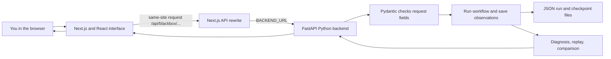

# Black Box AI — Beginner Notes

**Read this first if you are new to the project.** These notes explain what it is, who it helps, how the parts connect, what the ML model actually does, how to try the demo, and what you can safely say in an interview or LinkedIn post.

## 1. The short version: what is Black Box?

Black Box is a student project for **looking inside a small AI-style workflow when its answer goes wrong**.

Imagine a system answers a question from a document. The answer might look reasonable, but perhaps it chose an old policy, copied the wrong passage, or attached the wrong citation. Black Box saves the steps that led to the result. You can inspect those steps, see evidence for a likely failure point, try a correction, and compare the new run with the original.

The name is a metaphor: an AI workflow can feel like a “black box” when you only see its final answer. This project opens up a bounded example of that workflow so you can inspect what happened.

**One-sentence explanation:** “Black Box is a debugging and inspection demo for recorded workflows: it shows the sources, intermediate steps, checks, and what changed when I replay a correction.”

It is a **prototype for learning and demonstrating ideas**. It is not a universal AI debugger, an automatic bug fixer, a private document-storage service, or a proof that an answer is factually correct.

## 2. Who is it for?

The best audience is people who build or study AI software and want to understand its behavior:

- Students learning machine learning, retrieval, APIs, or software testing.
- Developers who want to inspect a workflow instead of seeing only its final answer.
- AI product and evaluation teams exploring trace review, replay, and failure analysis.
- Interviewers who want to see how you reason about evidence, testing, and limitations.

It is **not yet intended for people to upload confidential business, medical, school, or personal documents**. Run history on the public demo may be shared and temporary. Use fictional or non-sensitive material only.

## 3. What can I do with it?

The website has two related demonstrations:

### A. Document workflow — the main user-facing demo

Give it a question and one or more sources. It records four stages:

1. **Retrieve** possible documents (find sources with matching words).
2. **Select** one source (choose the source to use).
3. **Compose** an answer (in local mode, usually copy the selected source text; an explicit word-count question is counted locally; optional Gemini mode can write a broader answer).
4. **Validate** the answer, citation, and source against simple checks.

The local path does not understand meaning like a general chat model. It searches by exact words and usually returns the selected source as an extract. The separate local word-count feature recognizes a limited set of explicit questions such as “How many times does ‘integrity’ appear?”

Optional Gemini answering is a separate path. It sends the selected document text and question to Google only when that mode is selected and the user checks the consent box. Do not use sensitive documents. The checks on a Gemini answer are limited; a citation or matching quote does not prove that the answer interpreted the source correctly.

### B. Arithmetic workflow — the ML teaching demo

This older, controlled example adds two values through five recorded steps: retrieval, selection, calculation, answer generation, and validation. It can inject known mistakes such as a missing input, invalid selection, wrong calculation, or mismatched answer. A small trained model can rank which step likely caused the problem.

The arithmetic workflow is useful for demonstrating the ML experiment and trace/replay machinery. **Its model is not used to diagnose document questions.**

### The signature demonstration: failure → diagnosis → correction → comparison

1. Start a fictional failed run.
2. Inspect its answer, chosen source, and recorded steps.
3. Read the diagnosis and the evidence behind it. The document diagnosis uses rules over saved observations.
4. Replace an allowed checkpoint output with a reviewed correction.
5. Replay the remaining steps as a new run.
6. Compare the new branch with the original. The original remains saved, even when the correction still fails.

A **checkpoint** is a saved snapshot just before a step. A **replay** starts from one of these snapshots, reuses the earlier work, applies one replacement, and runs the later steps again. It is not an edit to the original run and it does not guarantee success.

For the current code demo, the guided failure uses fictional registration information and local mode. It does not represent a real Gemini failure or an AI-generated diagnosis.

## 4. How the website connects to the backend



In plain language:

1. The browser displays the pages and collects your choices.
2. Frontend code sends a request to a same-origin path beginning `/api/blackbox` (same-origin means it first goes to the website you already opened).
3. Next.js forwards that request to the Python backend using `BACKEND_URL` (the backend address setting; local development defaults to `http://127.0.0.1:8000`).
4. FastAPI receives the request. Pydantic checks that values have an allowed shape and size.
5. The backend runs the workflow, records its steps, and stores the result and checkpoints in JSON files.
6. The browser asks for the saved run, diagnosis, replay, or comparison and displays the returned data.

“API” means a defined way for two parts of a program to exchange requests and results. The frontend does not reach into Python files directly; it talks to backend routes such as `/document-runs`, `/diagnose`, and `/replay` through HTTP requests.

### Where to look in the code

| If you want to understand… | Start here |
|---|---|
| The user interface | `frontend/src/components/workspace/` |
| Frontend request and response types | `frontend/src/lib/api.ts` |
| Frontend-to-backend forwarding | `frontend/next.config.ts` |
| Document workflow and retrieval | `backend/app/services/documents.py` |
| Arithmetic workflow | `backend/app/services/workflow.py` |
| Routes (URLs the backend accepts) | `backend/app/routes/` |
| Run/checkpoint saving | `backend/app/services/store.py` |
| Trained arithmetic model | `ml/generate_dataset.py`, `ml/features.py`, `ml/train_model.py`, `ml/predict.py` |
| Retrieval measurements | `docs/RETRIEVAL_EVALUATION.md`, `docs/RETRIEVAL_REVIEW_PROTOCOL.md` |

## 5. Tech stack, in simple terms

| Part | Technology | What it does |
|---|---|---|
| Website | Next.js 16, React 19, TypeScript | Builds the pages and interactive browser interface. React makes reusable screen pieces; TypeScript checks many coding mistakes before running. |
| Styling | Tailwind CSS 4, CSS, Lucide icons | Controls layout, color, spacing, and icons. |
| Backend | Python 3.14, FastAPI, Pydantic, Uvicorn | Receives requests, checks inputs, runs workflows, and returns saved results. Uvicorn is the server that runs the Python API. |
| ML model | scikit-learn, NumPy, joblib | Trains and loads the small arithmetic step-ranking model. NumPy handles numeric data; joblib saves the trained model file. |
| Document reading | pypdf, defusedxml | Extracts text from supported PDFs and DOCX files (Word documents). It does not do OCR, so scanned image-only PDFs are unsupported. |
| Persistence | JSON files | Saves runs and checkpoints locally. JSON is a simple text format for structured data. |
| Optional external answer | Google Gemini through Python HTTPS | Can produce broader document answers after explicit consent. The API key stays on the backend; no Gemini call is needed for the local demo. |
| Checks | Python tests/benchmarks, Node tests, ESLint, TypeScript, Next.js build, GitHub Actions | Checks backend/ML behavior, frontend behavior, code style, types, and production compilation. |

There is no database server, vector database, embeddings model, new direct library for the recent improvements, or required paid API. **Embeddings** are number representations of meaning often used for semantic search; this project’s document retrieval does not use them.

## 6. What was trained? What was not?

There are two things people may call “AI” here. Keep them separate.

### The trained model: arithmetic step ranking

This model ranks which step in the controlled arithmetic trace looks most like the origin of a failure. It does not generate a fix or diagnose document questions.

How training works:

1. `ml/generate_dataset.py` simulates 100 simple scenarios with a fixed seed. Each scenario has five versions: one healthy run and four runs with a known injected fault. That creates **500 synthetic runs** (synthetic means computer-generated, not collected from real users).
2. Each run contains five steps. Separate labels tell training which step was deliberately made faulty. Those labels are kept apart from the observations used as model input, so the model cannot simply read the answer key.
3. The split is by scenario, not by individual run: 75 scenario IDs for training and 25 for testing. This keeps versions of the same scenario from appearing on both sides.
4. The `answer_mismatch` fault family is excluded from training and kept for an “unseen fault type” check. The training data therefore has **300 runs** (75 scenarios × 4 training variants).
5. For each step, the code makes a few clear features: its step type, whether it reported an error, whether a local rule found a mismatch, and whether required input was missing.
6. `DictVectorizer` turns those feature names into numbers, then **logistic regression** learns a score for each step (a simple statistical method for ranking/classification). The saved artifact is `ml/models/step_ranker.joblib`.

The scores are not calibrated probabilities (a score like 0.8 does not mean there is an 80% real-world chance). The model can abstain from listing suspects below a fixed threshold. It does not identify the kind of fault or write a correction.

### What did the ML evaluation show?

On the generated test traces, the model ranked the planted faulty step first in all measured cases. A fresh-seed benchmark also reported perfect synthetic scores. But the **simple `firstLocalEvidence` rules got the same result** on that benchmark. The comparison therefore does not prove the ML model is better. The generator creates clean, predictable arithmetic mistakes with observable clues; real agent traces may be noisy, ambiguous, or very different.

In an interview, say: **“The model learned to rank steps on a controlled synthetic arithmetic workflow. It matched a simple evidence-rule baseline there, so I do not claim real-world accuracy or ML superiority.”**

### Document retrieval is not trained ML

The document search/retrieval improvement is a hand-written lexical scoring rule (lexical means based on matching words). It is not a trained retriever, embeddings, or semantic search:

- Matching words in title/topic count twice as much as matches in source text.
- Common question words are removed; text is normalized; stronger matches rank earlier; ties preserve the original order.
- Archived sources can stay visible for failure diagnosis, while normal selection chooses a current source.

The first synthetic retrieval set had 12 documents and 20 queries. On its 17 supported queries, top-1 relevant-source selection changed from **4/17 to 15/17**; MRR changed from **0.2647 to 0.8824**. These are retrieval metrics, not answer-correctness scores, and the set was developer-authored and inspected.

A separate AI-agent-authored frozen review had 8 fictional documents and 16 queries. Supported top-1 source selection changed from **7/12 to 12/12**, but correct empty retrieval on unsupported queries got worse from **3/4 to 0/4**. This is agent-authored synthetic evidence, not human validation.

An additional abstention-filter experiment was rejected. The selected threshold was **0**, so it made no change; on that holdout set, the existing retrieval still returned a source for 19 of 20 unsupported questions. The candidate was not added to the product. This is a useful negative result: better word overlap does not tell us whether the document actually answers the question.

Quick metric meanings:

- **Top-1:** Did the first current source match the frozen relevance labels?
- **MRR (mean reciprocal rank):** Were relevant sources near the top? First place contributes 1, second contributes 1/2, and so on.
- **Recall@3:** What fraction of labeled relevant sources appeared in the first three results?
- **Abstention:** Did retrieval return no source? This does not mean the generated answer politely refused.

All these retrieval sets are small and synthetic. Do not combine their denominators or call them real-world accuracy.

## 7. How to try the demo

### Easiest path

Open the [public demo](https://blackbox-ai-delta.vercel.app/), enter the workspace, and try a fictional prepared example. If the free backend has been asleep, it may take a little while to wake.

To see the main story, choose a controlled failure, open its run, inspect the source and diagnosis, replay a reasonable correction, then compare the original and replay. Predict what should change before you click replay. The original should remain present even if the replay succeeds.

### Local development path

From the repository root in PowerShell, the README’s Windows setup is:

```powershell
powershell -ExecutionPolicy Bypass -File scripts\setup.ps1
.\.venv\Scripts\python.exe -B scripts\check.py
.\.venv\Scripts\python.exe scripts\start.py
```

Then open `http://127.0.0.1:3000/`. The setup script installs the already declared project dependencies and prepares a missing model. Do not run setup just to read the project. To stop the local services, press `Ctrl+C` in the launcher terminal.

### Public demo cautions

- Run history may be shared with other visitors; it is not private storage.
- The free backend may sleep, restart, or lose saved runs. Download results you need to keep.
- Use fictional or non-sensitive documents only. Uploaded text can be saved with a run.
- Gemini is optional. Its use sends selected document text and the question to Google after consent. Free-tier data handling is controlled by Google’s account terms; the app cannot verify billing or provider settings.
- The latest reviewed code has not been merged to `main` or deployed. The current public URL may show an earlier release. Do not say a feature is live until you verify it in the deployed demo.

## 8. Interview questions you should be ready for

**What problem does Black Box solve?**  
It makes a small answering workflow inspectable: I can see retrieved sources, the selected source, recorded output, and validation, then investigate and replay a correction.

**What exactly is the ML model?**  
A scikit-learn logistic-regression ranker that scores steps in a five-step synthetic arithmetic workflow. It uses observable mismatch/error/input features. It is not used for the document workflow.

**Why synthetic data?**  
It gives known fault labels and lets me test the whole trace-to-diagnosis pipeline reproducibly. Its weakness is that generated cases are simpler than real agent failures, so it cannot establish real-world performance.

**Why split by scenario?**  
Five versions are generated from each scenario. Splitting individual runs could put nearly identical versions in training and testing. Grouping by scenario reduces that leakage (information shared between the train and test sets).

**Why is there a separate rule baseline?**  
To check whether the model adds value beyond simple checks. The baseline matches the trained model on the fresh synthetic benchmark, so I report the model as a learning demonstration, not a superior solution.

**Is document retrieval semantic search?**  
No. It scores exact normalized word overlap, with title/topic words weighted more. It has no embeddings or trained retriever and can miss synonyms or matching words that do not answer the question.

**Does a passing validation mean the answer is true?**  
No. It means the bounded checks passed, such as source/citation or exact expected output. A matching quote may still fail to answer the user’s actual question.

**Can the system automatically fix itself?**  
No. I review a replacement output at a supported checkpoint. The backend validates the shape, reuses the earlier trace, reruns later steps, and saves a separate branch. A wrong correction can still fail.

**Why JSON files instead of a database?**  
The scope is a small single-worker learning demo. Atomic file replacement and a process lock help with local writes, but this is not multi-worker shared storage or a production data platform.

**What would you improve next?**  
Use more realistic, independently human-labeled document/query data; evaluate answerability and unsupported questions; then only add stronger retrieval or storage after measurements show the need.

**Which parts did you build with AI assistance?**  
Be honest and specific about your own contribution and where tools helped. Do not claim code you cannot explain. Use these notes to learn the code path, then change an input, predict what will happen, and verify it yourself.

## 9. How to promote it honestly

Lead with the visible problem and the demo, not with a list of libraries or an inflated accuracy percentage. Show a short screen recording or screenshots of the failed trace, evidence-based diagnosis, correction, and side-by-side comparison. Explain that the original stays unchanged. Then say what was measured and what remains weak.

Good headline:

> I built a small debugging workspace for document-answer workflows: inspect the sources, trace a failure, replay a reviewed correction, and compare it with the untouched original.

Example LinkedIn description:

> I built **Black Box**, a student prototype for inspecting how a document-answer workflow reached its result. It records retrieval, source selection, answer composition, and validation, then lets me replay a reviewed checkpoint correction as a separate branch while preserving the original run.
>
> The project also includes a separate synthetic arithmetic step-ranking experiment using scikit-learn. I evaluated a transparent exact-word retrieval change on small synthetic sets and published both gains and failures—including worse unsupported-question abstention on a separate review set. Document diagnosis is rule-based; the retriever is not a trained model. This is a learning prototype, not a private document service or an autonomous repair system.

Before posting, verify the public demo shows the version you describe. The latest code is on a draft review branch and has not been deployed to production. Avoid phrases like “100% accurate AI,” “automatically fixes hallucinations,” “trained RAG model,” “production-ready,” or “beats embeddings.”

## 10. Small glossary

| Term | Plain-English meaning |
|---|---|
| Backend | The server-side part that receives requests, runs Python code, and saves results. |
| Frontend | The screens and controls you use in the browser. |
| Workflow/trace | A sequence of saved steps showing how a run happened. |
| Retrieval | Finding possible source documents. |
| Lexical | Based on matching words, not understanding meaning. |
| Validation | A set of checks on the recorded result; not a guarantee of truth. |
| Checkpoint | A saved snapshot before a workflow step. |
| Replay | Continue from a saved snapshot with a reviewed replacement. |
| Branch | A new run based on an older run, saved separately. |
| Synthetic dataset | Computer-generated examples with known labels. |
| Feature | A small measured clue given to a model, such as “this calculation does not match its inputs.” |
| Logistic regression | A statistical method that learns scores for categories; here, which step should rank as suspicious. |
| Baseline | A simpler method used for comparison. |
| Overfitting/data leakage | When a test looks too easy because training has already seen closely related examples or answers. |
| CORS | A browser rule about which websites may call a server; it is not login or access control. |
| Persistence | Saving data so it remains after a request finishes. |

## 11. A good way to learn it

Do not try to memorize every file. Start one fictional failure and follow its run ID through the screen, API response, backend route, service, and saved JSON record. Before each replay, write down which steps you think will be reused and which will run again. Then check your prediction. That is the fastest way to make the project feel like yours.

For the deeper diagrams and source-specific detail, continue with [Understand the Project](docs/UNDERSTAND_THE_PROJECT.md), [Architecture](docs/ARCHITECTURE.md), [Student Walkthrough](docs/STUDENT_WALKTHROUGH.md), and [Interview Guide](docs/INTERVIEW.md).
